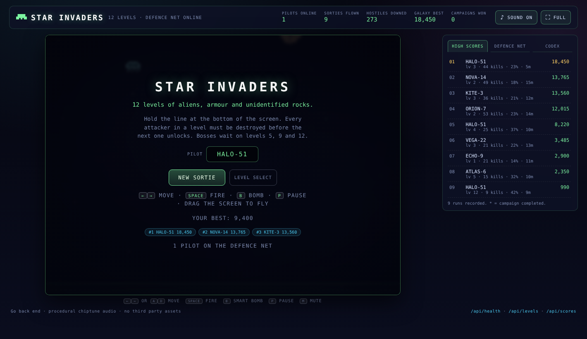
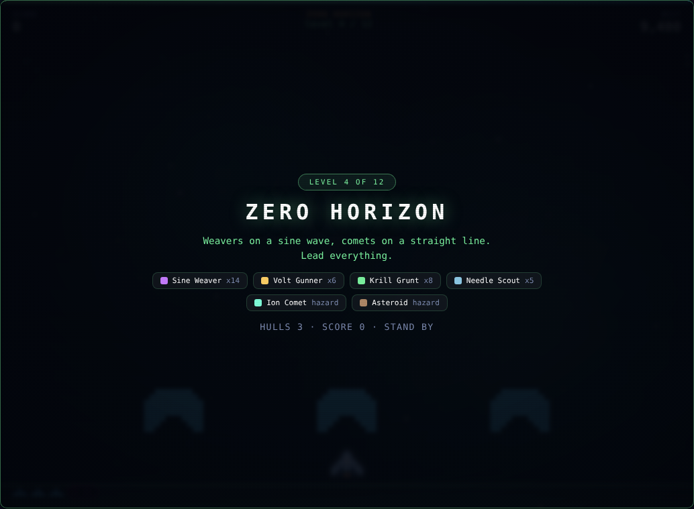
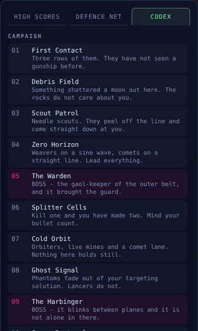
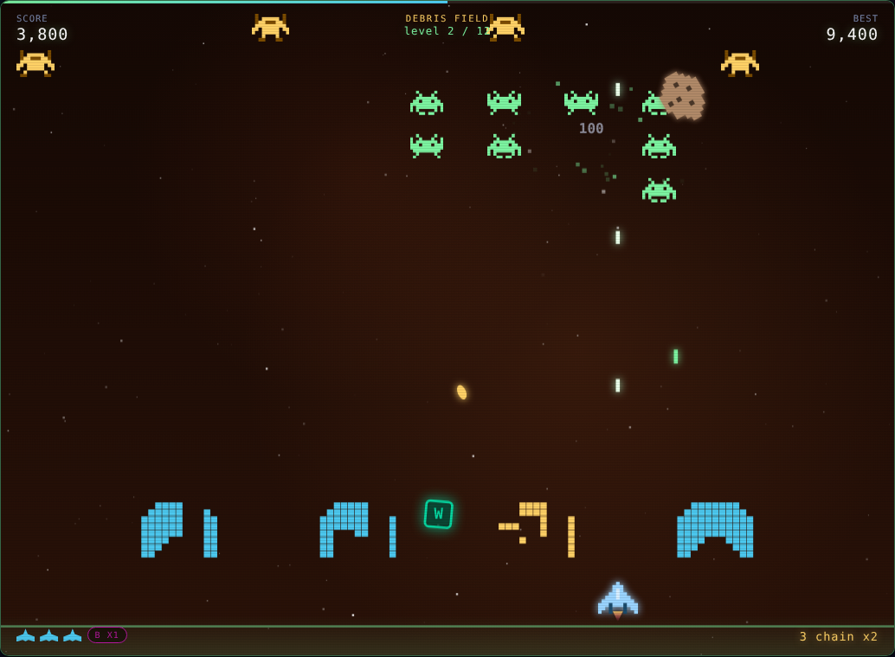
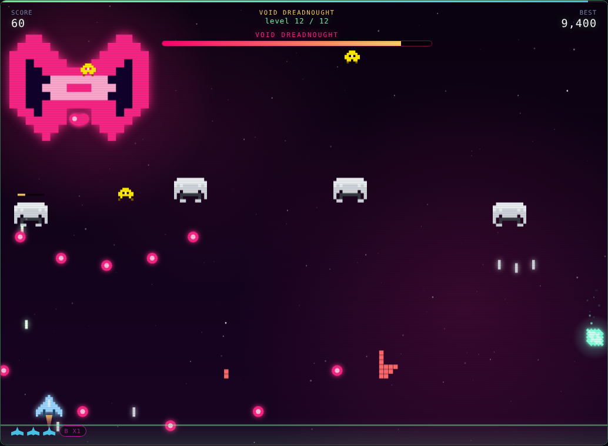
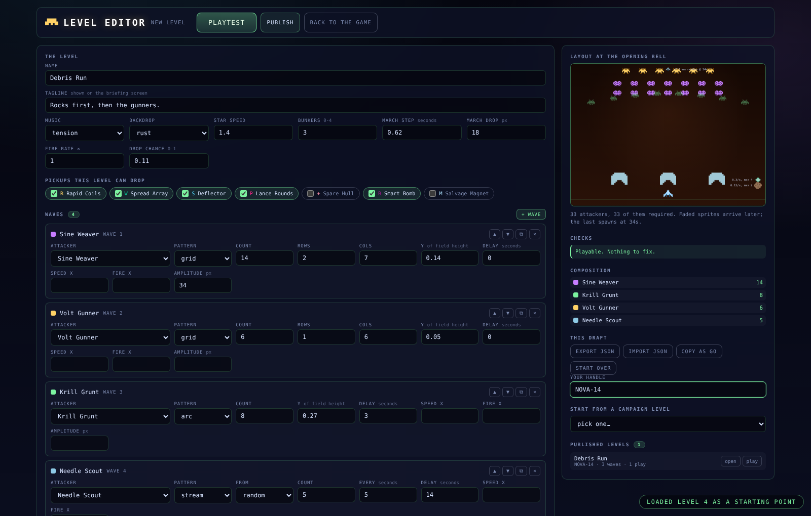
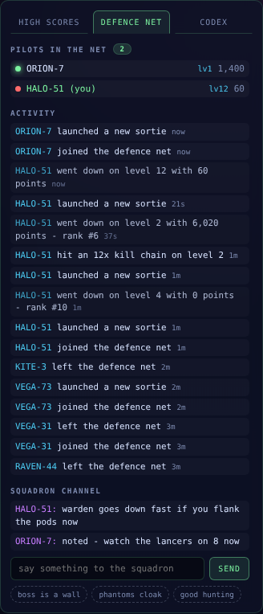
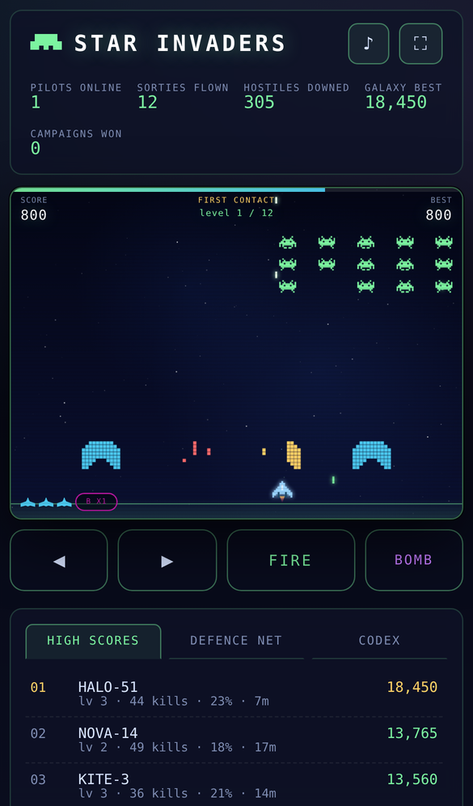

# Star Invaders

A twelve-level browser shooter in the Space Invaders lineage, with a Go back
end that keeps the campaign definition, a persistent global high score table,
and a live "defence net" that lets everyone playing see what everyone else is
doing.

No game engine, no build step, no third party assets. The server is pure Go
standard library; the client is plain ES modules, canvas, and Web Audio.

```
go run .        # then open http://localhost:8080
```



## What is in the box

**Twelve levels, each with a mix of attackers.** Every level must be cleared
of its hostiles before the next one unlocks. Levels 5, 9 and 12 add a
multi-phase boss on top of the regular waves.

| # | Level | Attackers | Hazards |
|---|-------|-----------|---------|
| 1 | First Contact | grunts, scouts | - |
| 2 | Debris Field | grunts, gunners, scouts | asteroids |
| 3 | Scout Patrol | grunts, gunners, diving scouts | asteroids |
| 4 | Zero Horizon | weavers, gunners, grunts, scouts | comets, asteroids |
| 5 | **The Warden** | boss + grunt guard, scouts | asteroids |
| 6 | Splitter Cells | splitters, weavers, gunners, scouts | asteroids, derelict |
| 7 | Cold Orbit | orbiters, gunners, weavers | comets, mines |
| 8 | Ghost Signal | phantoms, lancers, gunners | mines, comets |
| 9 | **The Harbinger** | boss + phantoms, scouts | comets |
| 10 | Swarm Protocol | swarmlets, lancers, gunners | asteroids, comets |
| 11 | Siege Line | bulwarks, gunners, splitters, phantoms | comets, asteroids, mines |
| 12 | **Void Dreadnought** | final boss + bulwarks, swarmlets, lancers | everything |

Every level opens on a briefing naming exactly what is about to arrive, and in
what numbers:



Ten alien archetypes, four "unknown space objects" and three bosses, each with
its own silhouette and behaviour: marching formations, divers that peel off and
come at you, sine weavers, orbiters, phantoms that cloak out of your targeting
solution, splitters that become two scouts when killed, armoured bulwarks that
halve head-on damage, and suicide lancers. The drifting objects do not shoot
and cannot be reasoned with. The in-game codex lists every one of them, built
from the same definitions the game is played from:



A level in progress - the wall half cleared, a gunner arc above it, an asteroid
drifting through, a spread-shot pickup on its way down, and four bunkers in
varying states of erosion:



Bosses hold the screen on levels 5, 9 and 12, each running through several
attack phases as its hull comes apart:



**Sound.** Every effect is synthesised at runtime with the Web Audio API -
pulse, triangle and noise voices through a limiter. Cannon fire, hits, armour
pings, explosions scaled by target size, shield breaks, pickups, the extra-life
jingle, boss klaxons, the smart bomb, and the four-tone march tick that speeds
up as a formation thins out.

**Music.** A small chiptune tracker runs seven looping tracks (menu, march,
tension, boss, swarm, siege, final) plus win and lose jingles, scheduled ahead
of the audio clock so it stays in time. Nothing is streamed or downloaded.

**A level editor.** `/editor.html` builds the same declarative script the
shipped campaign is written in: waves, hazards and a handful of knobs. It
previews where everything starts, runs the real game engine over the draft on
demand, and publishes finished levels to the server for anyone to play.



The preview is drawn by the game's own spawn-plan builder rather than a
second implementation, so it cannot drift away from what Playtest gives you.
Drafts can start from a blank level or from any campaign level, import and
export as JSON, and copy out as a Go literal to paste into
`internal/game/levels.go` if a level is good enough to join the campaign.

**The defence net.** Everyone connected shares a roster, a global activity feed
("ORION-42 destroyed The Warden on level 5") and a squadron chat channel. High
scores are announced to everyone the moment they land.



## Running it

```bash
go run .                      # http://localhost:8080
go run . -addr :3000          # different port
go run . -dev                 # serve ./web from disk, no rebuild to see edits
go run . -data /var/lib/si    # where the score table lives
```

`PORT`, `ADDR` and `STAR_INVADERS_DATA` work as environment overrides, so the
binary drops straight into a container or a PaaS dyno.

```bash
make build      # ./bin/star-invaders, assets embedded
make test       # go vet + go test -race ./...
make run
make docker
```

The web assets are embedded with `//go:embed`, so the built binary is the
entire deployment: one file, no runtime dependencies, no CGO.

## Controls

| | |
|---|---|
| Move | `←` `→` or `A` `D`, or drag anywhere on the play field |
| Fire | `Space` (hold), or drag-to-fly fires automatically |
| Smart bomb | `B` |
| Pause | `P` or `Esc` |
| Mute / fullscreen | `M` / `F` |

On a touch screen the on-screen pad appears automatically, laid out under the
play field rather than over it, and the HUD scales with the field so it stays
in proportion on a small screen.



Pickups drop from kills: rapid coils, spread array, lance (piercing) rounds,
a deflector that eats one hit, a salvage magnet, a spare hull, and smart bomb
charges. Killing quickly builds a chain multiplier up to 8x. Clearing a level
without being hit pays a flawless bonus.

## API

| Method | Path | Purpose |
|---|---|---|
| `GET` | `/api/health` | liveness, version, players online |
| `GET` | `/api/levels` | the whole campaign: archetypes, levels, powerups, balance rules |
| `GET` | `/api/scores?limit=N` | top N runs |
| `POST` | `/api/runs` | mint a run token at game start |
| `POST` | `/api/scores` | submit a finished run against its token |
| `GET` | `/api/stats` | lifetime aggregates across all players |
| `GET` | `/api/stream` | Server-Sent Events: roster, feed, chat, high scores |
| `POST` | `/api/presence` | report level/score/lives to the roster |
| `POST` | `/api/events` | report a milestone (level cleared, boss down, extra life) |
| `GET`/`POST` | `/api/chat` | squadron channel |
| `GET` | `/api/userlevels` | levels built in the editor |
| `POST` | `/api/userlevels` | publish one; returns a single-use edit key |
| `POST` | `/api/userlevels/validate` | check a draft without storing it |
| `GET`/`PUT`/`DELETE` | `/api/userlevels/{id}` | read, edit or remove one |
| `POST` | `/api/userlevels/{id}/play` | play counter |

### Why SSE rather than WebSockets

The live layer is one-way fan-out plus a handful of small POSTs. Server-Sent
Events cover that with `net/http` alone, reconnect on their own in the browser,
and keep the project at **zero external Go dependencies**. The SSE connection
*is* the presence record: when the request ends, the player leaves the roster.

### How levels are validated

A level is checked by one validator (`internal/game/validate.go`), used by the
editor as you type, by the API before anything is stored, and by the test
suite against the twelve shipped levels. It reports two kinds of problem:
fatal ones that make a level unplayable or unwinnable - no attacker that has
to die, a boss without the boss pattern, a required archetype used as a
never-ending hazard, an entity budget a browser would struggle with - and
advice, which the editor shows but does not block on.

Submitted levels are normalised first: text trimmed, numbers clamped into
range, unknown powerups dropped, and the `boss` field derived from the waves
rather than trusted. An author cannot store a level the client could not run.

Editing or removing a published level needs the edit key handed out once when
it was published. The key is persisted but never served, so a listing cannot
leak one.

### Where the game logic lives

The levels, the bestiary and the balance constants are defined in Go
(`internal/game`) and served as JSON. The client is a renderer and a simulator
for that script, so rebalancing a level means editing one Go file - the client
needs no changes. The simulation itself necessarily runs in the browser, which
has consequences for scores (below).

### About score validation

A browser game cannot have authoritative scoring without running the
simulation server-side, which this does not do. What the server does instead is
raise the cost of a casual fake:

- a run token is minted at game start, is single-use, and expires after 6 hours;
- submissions are checked against a per-level score ceiling derived from the
  actual contents of the levels played (starting on level 9 does not inherit
  the allowance for levels 1-8);
- a run has to have lasted long enough to be physically possible, unless the
  score is too small to be worth forging;
- feed lines are composed server-side from an allow-list of milestone kinds, so
  no client can put arbitrary text in front of other players;
- names and chat are sanitised and rate limited per IP.

A determined person with the dev tools open can still post a fake score. That
is a property of the genre, not an oversight.

## Layout

```
main.go                  flags, embedded assets, graceful shutdown
internal/game/           archetypes, the 12 level scripts, score ceilings
internal/scores/         file-backed leaderboard + lifetime stats
internal/userlevels/     file-backed shelf of levels built in the editor
internal/hub/            SSE fan-out: roster, feed, chat
internal/api/            HTTP routes, run tokens, rate limiting, sanitising
web/index.html           shell
web/css/style.css        arcade chrome
web/js/audio.js          synthesised SFX + chiptune tracker
web/js/sprites.js        pixel-grid sprites, rasterised and cached
web/js/entities.js       behaviours, marching formation, destructible bunkers
web/js/game.js           simulation, collision, scoring, renderer
web/js/net.js            campaign fetch, SSE, presence, score submission
web/js/ui.js             HUD, overlays, leaderboard, roster, codex
web/js/plan.js           level script -> spawn queue, shared by game and editor
web/js/editor.js         the level editor
web/js/main.js           boot and wiring
test/js/                 node --test suite for the formation and bunker logic
docs/screenshots/        the images used above
```

## Data

The score table is a single JSON file (`data/scores.json` by default), written
atomically every 20 seconds and on shutdown. It keeps the top 500 runs plus
lifetime aggregates. Levels built in the editor live beside it in
`data/userlevels.json`, up to 300 of them. A corrupt file is moved aside
rather than taking the server down with it. There is no database to run.

Community levels are playable but never scored on the leaderboard: the
server's anti-forgery ceilings are derived from the contents of the shipped
levels, and a level anyone can author has no such bound.

## Browser support

Anything with ES modules, canvas and Web Audio: current Chrome, Firefox, Safari
and Edge, desktop or mobile. Audio only starts after the first interaction,
which is a browser rule, not a bug.
